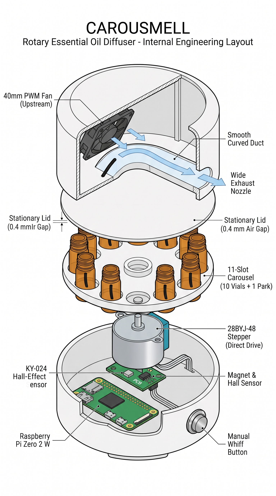
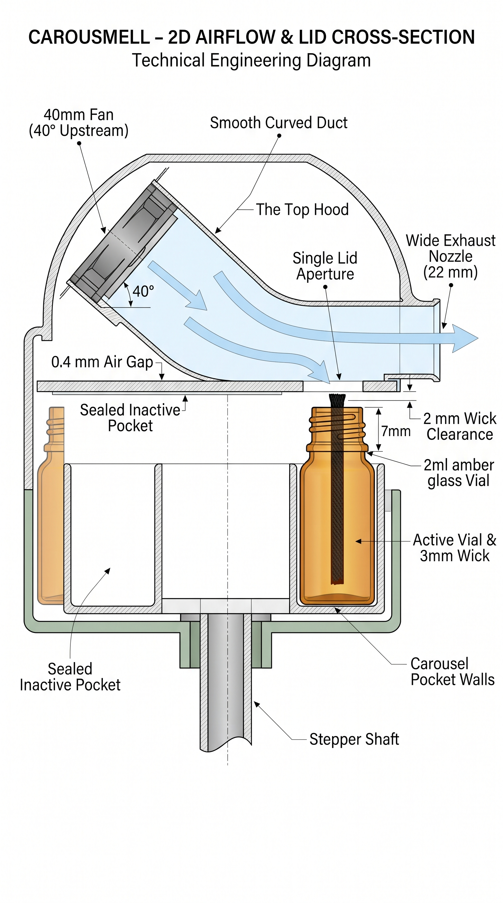
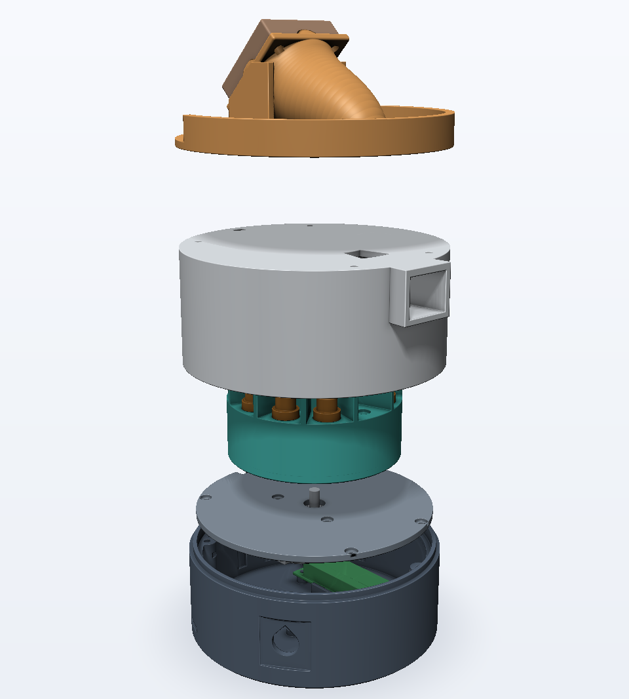
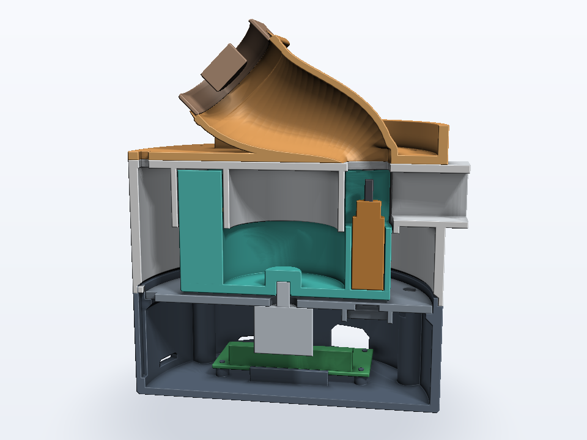

# Carousmell - An Overnight Olfactory Carousel

This repository documents a personal DIY project: a whisper-quiet, automated multi-scent diffuser I am building for my own **overnight olfactory training** experiments (e.g., around hyposmia / smell rehabilitation).

Instead of running a single continuous scent that causes olfactory fatigue, the prototype holds **10 pure single-note essential oil vials** plus **1 empty "park" slot** in a 3D-printed 11-slot rotary carousel. Throughout the night, it wakes up at regular intervals, rotates to a random vial, delivers a gentle, brief pulse of scent using a quiet PWM fan, and returns to the sealed park position.

> [!Note]
>
> * **Personal Experiment & Disclaimer:** This repository is strictly personal documentation of a private, non-commercial hobby build, shared for informational and educational reference only. It is **not a certified medical device**, not a commercial product, and not medical advice or an instruction for others to build or use. Please consult a healthcare professional for medical advice regarding smell loss.
> * There is some research on using smell overnight to improve memory, and on actively training with smell for smell rehabilitation, but nothing quite along the lines of what **Carousmell** is doing—this is purely experimental and **unproven**. New research appears every now and then, so it's worth checking the scientific literature directly.

---

## Concept & Architecture

| Internal Engineering Layout | 2D Airflow & Lid Cross-Section |
| :---: | :---: |
|  |  |

| Parametric CAD — Exploded Assembly | Parametric CAD — XZ Airflow Cutaway |
| :---: | :---: |
|  |  |

> See [docs/cad_design_plan.md](docs/cad_design_plan.md) for the full parametric mechanical specification, Creality K1C DFM guidelines, and Go (`soypat/gsdf`) STL/visualization generator (`cad/`).

### How It Works
1. **Plug-and-Play Startup:** On power-up, the stepper motor slowly rotates the carousel until the contactless Hall-effect sensor detects the single magnet under **Slot 0 (empty park slot)**.
2. **Wait / Washout:** The device waits **30 minutes** completely silent, dark, and sealed (motor coils de-energized, fan off).
3. **Random Scent Selection:** Picks a random vial from the 10 oils **without replacement** (reshuffling once all 10 have been used).
4. **Sequential Delivery (No Scent Mixing):**
   - **Move (Fan OFF):** Rotates to the selected vial, then turns all stepper coils off.
   - **Pulse (Motor OFF):** Smoothly ramps the upstream Noctua 40 mm PWM fan up for **20–45 seconds**, pushing clean room air across the exposed fiber wick and out a wide directional exhaust nozzle, then ramps down to `0%`.
   - **Park (Fan OFF):** Rotates back to **Slot 0** and de-energizes the motor.
5. **Manual "Whiff Now" Button:** Pressing the panel-mount push button triggers an immediate single scent pulse and returns the carousel to Slot 0.
6. **Power Off:** Designed to be turned off simply by unplugging (using a read-only overlay filesystem on Raspberry Pi OS, or bare-metal/MicroPython on a possible future Raspberry Pi Pico version).

### Key Design Choices
- **Upstream "Push" Airflow:** The fan sits *upstream* pushing clean room air past the active wick rather than pulling oil vapors through the fan bearings and plastic blades.
- **Zero-Friction Air-Gap Seal:** Uses a close-tolerance **0.3–0.5 mm non-contact air gap** between the carousel pockets and stationary lid (no tacky silicone drag and no odor-emitting grease).
- **Bedroom-Friendly:** No status LEDs left on during sleep, ultra-quiet Noctua PWM fan, and motor coils powered down between moves.

---

## What I Used

### Electronics & Control
| Component | Specification / Model | Qty | Notes |
| :--- | :--- | :---: | :--- |
| **Controller (Prototype)** | Raspberry Pi Zero 2 WH (pre-soldered header) | 1 | Headless Raspberry Pi OS Lite; Wi-Fi disabled after tuning. *(I may later experiment with a **Raspberry Pi Pico H / Pico 2** version.)* |
| **Storage** | 32 GB microSD card | 1 | For Pi Zero 2 WH OS & daemon (read-only overlay enabled for safe unplugging). |
| **Power Supply** | 5V / 2A–2.5A Micro-USB power adapter | 1 | Standard Pi power supply. |
| **Heatsink (Optional)** | ~14 × 14 × 6 mm stick-on aluminum heatsink | 1 | Fits under the 40-pin header clearance. |
| **Stepper Motor + Driver** | 28BYJ-48 (5V) + ULN2003 driver board | 1 | Drives the carousel directly via its 5 mm double-D shaft. |
| **Airflow Fan** | Noctua NF-A4x10 **5V PWM** (40 × 40 × 10 mm, 4-pin) | 1 | 5V PWM variant, mounted with its included silicone anti-vibration pins. |
| **Homing Sensor** | KY-024 Hall-Effect Sensor Module (**3.3V–5V**) | 1 | Powered at **3.3V** so digital output (`D0`) is Pi-safe. |
| **Homing Magnet** | 5 × 2 mm neodymium disc magnet | 1 | Embedded under Slot 0 (with polarity matched to the Hall sensor before gluing). |
| **Manual Trigger Button** | 12 mm panel-mount momentary ATX push button | 1 | Normally Open (NO), threaded M12 barrel with hex nut, pre-wired 2-pin female Dupont plug (`POWER SW`). |

### Wiring & Hardware
| Item | Specification | Qty | Notes |
| :--- | :--- | :---: | :--- |
| **Jumper Wires (F–F)** | 15 cm Female-to-Female Dupont cables | ~10 | Connects ULN2003 (`5V`, `GND`, `IN1–IN4`) and KY-024 (`3.3V`, `GND`, `D0`) to the Pi header. |
| **Jumper Wires (M–F)** | 15 cm Male-to-Female Dupont cables | 3 | Connects the Noctua fan's female 4-pin plug (`5V`, `GND`, `PWM`) to the Pi header. |
| **Fasteners** | M3 screws & nuts (assorted lengths) | ~8–12 | Mounts stepper motor tabs, driver/sensor boards, and enclosure sections. |

### Olfactory Consumables
| Item | Specification | Qty | Notes |
| :--- | :--- | :---: | :--- |
| **Sample Vials** | 2 ml amber glass vials with open-top caps & PTFE/silicone septa | 10 | Each septum has a small ~2.5 mm `+` slit cut into it (PTFE side facing down toward the oil). |
| **Diffuser Wicks** | 3 mm black synthetic fiber diffuser sticks (*Faserstäbchen*) | 10 | Trimmed to ~40 mm each, leaving ~6–10 mm exposed above the vial cap. |
| **Essential Oils** | 10 pure, single-note essential oils | 10 | I used the Casida 4-oil olfactory training set + Casida Top 6 set. |

### 3D-Printing Materials
- **Prototyping & Bottom Base:** **PLA / Hyper PLA** (used for fit-checking and the isolated electronics base).
- **Oil-Exposed Parts (Carousel, Stationary Lid, Exhaust Hood):** I chose **PETG** (3–4 wall loops) because pure citrus (*limonene*) and clove (*eugenol*) oil vapors gradually degrade PLA and dissolve ABS/ASA, whereas PETG resists essential oil vapors well.

---

## Project Status & Next Steps

- [x] Component selection finalized
- [x] **3D-Printed Enclosure & Carousel (`cad/`)** — Parametric Go (`soypat/gsdf`) CAD generator exporting Creality K1C-ready `.stl` files, renders, and interactive viewer (see [docs/cad_design_plan.md](docs/cad_design_plan.md))
- [ ] **Wiring Notes (`docs/wiring.md`)** — *TBD: Raspberry Pi 40-pin GPIO mapping used in my build*
- [ ] **Software & OS Setup (`firmware/`)** — *TBD: Headless Pi OS setup, homing/stepping/PWM daemon, manual button handler, and read-only filesystem config*
- [ ] **Raspberry Pi Pico Port (`firmware-pico/`)** — *Maybe later: lower-cost, instant-boot, unplug-safe microcontroller version*

---

## Repository Structure (Planned)

```text
.
├── LICENSE                   # Multi-license summary
├── LICENSES/
│   ├── Apache-2.0.txt        # Software & firmware license
│   └── CERN-OHL-P-2.0.txt    # Hardware, CAD & documentation license
├── README.md
├── docs/
│   ├── cad_design_plan.md    # Parametric mechanical spec & Creality K1C DFM guide
│   ├── diagram_1.jpg         # Internal engineering layout (concept)
│   ├── diagram_2.jpg         # 2D airflow & lid cross-section (concept)
│   ├── render_exploded.png   # Shaded 3D CAD exploded assembly render
│   ├── render_cutaway.png    # Shaded 3D CAD XZ airflow cutaway render
│   ├── render_isometric.png  # Shaded 3D CAD isometric render
│   ├── cross_section.svg     # Exact SDF 2D cross-section & floorplan blueprint
│   ├── viewer.html           # Standalone interactive 3D WebGL CAD viewer
│   └── wiring.md             # Pin-by-pin wiring notes (TBD)
├── cad/                      # Parametric Go (soypat/gsdf) CAD scripts & CLI generators
└── firmware/                 # Control script & systemd service (TBD)
```

---

## License

This project uses two permissive licenses depending on the component (see [LICENSE](LICENSE)):

- **Software & Firmware** (`firmware/`, `firmware-pico/`): [Apache License 2.0](LICENSES/Apache-2.0.txt) (`Apache-2.0`)
- **Hardware, 3D CAD & Documentation** (`cad/`, `docs/`, `README.md`): [CERN Open Hardware Licence Version 2 – Permissive](LICENSES/CERN-OHL-P-2.0.txt) (`CERN-OHL-P-2.0`)
